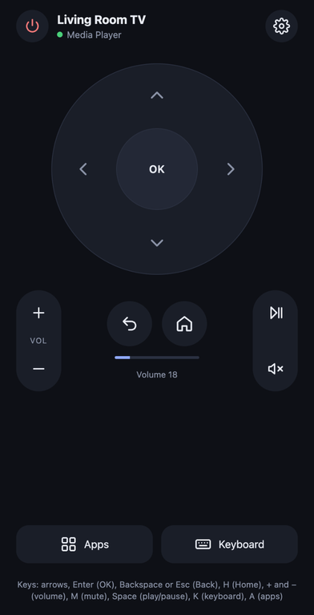
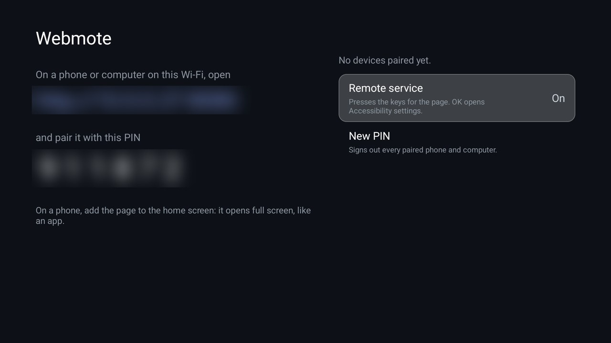
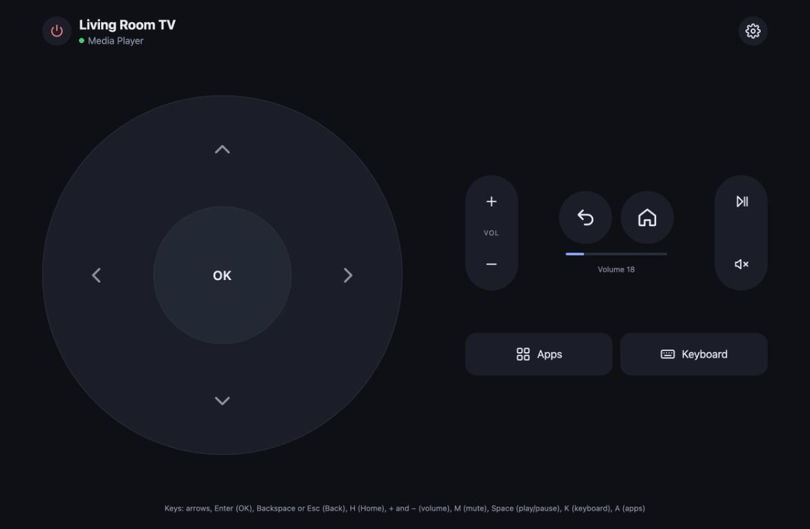

  

  <strong>A remote for your Android TV or car head unit, in your phone's or computer's browser</strong>

  
  
  
  
  

<h1>Webmote</h1>

Webmote is an open-source remote for Android TV and Google TV that works in a web browser. Install it on the TV, open the address it shows on any phone, tablet or computer on the same Wi-Fi, type the PIN from the TV screen, and you have a remote like Google TV's: D-pad, OK, Back, Home, volume, play/pause, an Apps sheet and a keyboard for typing searches.

There is nothing to install on the phone and no account to sign in to, and nothing leaves your home network. Add the page to your phone's home screen and it opens full screen, like an app.

It also runs on Android car head units and tablets, where passengers get big track controls, volume, Back, Home, recent apps, the apps and a keyboard, over the car's hotspot. See <a href="#in-the-car">In the car</a>.

And it works with <strong>Home Assistant</strong>: each TV shows up there by itself, and once paired with its PIN it's a media player and a remote for dashboards, automations and voice. See <a href="#home-assistant">Home Assistant</a>.

<h2>Screenshots</h2>

  
  &nbsp;&nbsp;
  

Left: the remote page (demo TV and apps). Right: Webmote on the TV, with the address and PIN blurred.

  

On a computer or a tablet on its side, the remote spreads out to fit the window (demo TV).

<h2>Features</h2>

<ul>
  <li><strong>Google-TV-style remote</strong>: D-pad with OK, Back, Home, volume up/down, mute, play/pause, and TV settings</li>
  <li><strong>Car head units and tablets</strong>: a touch layout with previous, play/pause and next in place of the D-pad, recent apps, and the device's own app drawer; works over a hotspot with no internet</li>
  <li><strong>Home Assistant</strong>: an integration (install with HACS) that finds the TVs on the network, pairs with the PIN, and adds each as a media player (on/off, volume, mute, play/pause, tracks, apps as sources), a remote (every button, typing and searching), a button for each remote key, and Webmote's updates</li>
  <li><strong>QR code</strong>: Webmote's screen shows one for its address, so a phone opens the remote by pointing its camera at it</li>
  <li><strong>Turn off and on</strong>: hold the power button for a second to turn the TV off, so a stray tap doesn't; tap it to turn the TV back on (Standby keeps Webmote on the network while the TV is off)</li>
  <li><strong>Updates itself</strong> from this repository's releases, once a day; switch it off on Webmote's screen. Silent on Android 12 and newer when installed with <code>install.sh</code>; elsewhere the TV asks once, only when you open Webmote's screen or ask for the update</li>
  <li><strong>Apps sheet</strong>: every app on the TV with its banner; tap one to open it</li>
  <li><strong>Keyboard</strong>: type on your phone and the text appears in the TV's focused search or text box, then Enter to search</li>
  <li><strong>Now playing</strong>: the TV's name, the app in front, and the volume, kept up to date</li>
  <li><strong>Hold to repeat</strong> on the D-pad and volume, with a small vibration on phones that have it</li>
  <li><strong>Desktop keyboard shortcuts</strong>: arrows, Enter, Backspace or Esc, H, + and −, M, Space, N and P for next and previous track, K for the keyboard, A for apps</li>
  <li><strong>Home-screen app</strong>: a web app manifest and icons, so it opens full screen from the home screen</li>
  <li><strong>Paired, not open</strong>: a 6-digit PIN pairs each browser; wrong guesses lock pairing for longer each time; <strong>New PIN</strong> signs every device out. See <a href="#security">Security</a></li>
  <li><strong>Small</strong>: one ~45 KB APK, plain Java, no libraries, no tracking</li>
  <li>A <a href="https://github.com/Gathin23/cleanyourtv/blob/main/docs/modules.md">module card</a> for the <a href="https://github.com/Gathin23/cleanyourtv">Clean Your TV</a> launcher ("Webmote · Phone remote"); on any other home it's an ordinary app</li>
</ul>

<h2>Requirements</h2>

<ul>
  <li>An Android TV or Google TV device, or an Android car head unit or tablet, on <strong>Android 9 or newer</strong> (on Android 13 and newer the D-pad works everywhere; see Known Limitations for 9 to 12)</li>
  <li>A phone, tablet or computer with a modern browser, <strong>on the same network</strong> as the TV (in a car: the same hotspot)</li>
  <li>To install: a computer with <a href="https://developer.android.com/tools/releases/platform-tools">ADB</a> and Developer options → Network debugging on the TV, or any sideloading app on the TV</li>
</ul>

<h2>Installation and Setup</h2>

<h3>From a release (recommended)</h3>

<ol>
  <li>Download <code>Webmote-x.y.z.apk</code> from the <a href="../../releases/latest">latest release</a>.</li>
  <li>Install it and switch on its remote service:
<pre>
TV_HOST=&lt;tv ip&gt; APK=Webmote-0.5.0.apk ./install.sh
</pre>
  This installs the APK with <code>adb</code>, adds Webmote's remote service to the accessibility services already on (keeping theirs), and opens Webmote on the TV.</li>
</ol>

Installing without a computer: sideload the APK with any file manager or downloader app, open <strong>Webmote</strong>, choose <strong>Remote service</strong> and switch on <strong>Webmote</strong> in Accessibility settings. Some TVs hide that screen; then use <code>install.sh</code> once from a computer.

<h3>From source</h3>

JDK 17 and Android SDK platform 34 with build-tools 34.0.0:

<pre>
TV_HOST=&lt;tv ip&gt; ./install.sh
</pre>

It builds the app and installs it the same way. To build only: <code>./gradlew assembleRelease</code>; the JVM tests run with <code>./gradlew testReleaseUnitTest</code>, and the Home Assistant integration's with <code>pip install -r tests/requirements.txt</code> then <code>pytest tests</code> (Python 3.12 or newer). Where macOS blocks the stock <code>adb</code>, set <code>CLEANYOURTV</code> to a clone of <a href="https://github.com/Gathin23/cleanyourtv">Clean Your TV</a> with its tools set up, and its <code>tools/tv.py</code> is used instead.

<h2>Usage</h2>

<ol>
  <li>Open <strong>Webmote</strong> on the TV. It shows an address like <code>http://192.168.1.20:8080</code>, a QR code of it, and a 6-digit PIN.</li>
  <li>Point your phone's camera at the QR code, or open the address in the browser on your phone or computer, and type the PIN. The TV also shows the PIN in a corner while the browser is on the pairing page, so after the first time you can skip opening Webmote on the TV. The browser stays paired.</li>
  <li>Add it to your home screen:
    <ul>
      <li><strong>iPhone and iPad (Safari)</strong>: Share → <strong>Add to Home Screen</strong>. It opens full screen, like an app.</li>
      <li><strong>Android (Chrome)</strong>: ⋮ → <strong>Add to Home screen</strong>. Over plain HTTP, Chrome adds a shortcut that opens in a browser tab; tap the full-screen button at the top of the remote to hide the browser bars.</li>
      <li><strong>Computer</strong>: bookmark it, and use the keyboard shortcuts listed under the remote.</li>
    </ul>
  </li>
</ol>

The address is the TV's address on your network. If your router hands it a new one, Webmote shows the new address; give the TV a fixed address (a DHCP reservation in the router) to keep the home-screen icon working. If port 8080 is taken, Webmote uses the next free port, up to 8089.

On the TV, <strong>New PIN</strong> (press OK twice) makes a new PIN and signs out every paired phone and computer.

For scripts and home automation, the same calls the page makes are documented in <a href="docs/api.md">docs/api.md</a>.

<h3 id="in-the-car">In the car</h3>

Aftermarket Android head units (the Android tablets built into a car stereo) run Webmote like a TV, with a layout for touch: previous, play/pause and next, volume, Back, Home, recent apps, the head unit's apps and a keyboard. There's no home Wi-Fi in a car, so join the phone and the head unit through a hotspot, either way round:

<ul>
  <li><strong>The head unit on the phone's hotspot</strong> (the usual way, for the head unit's internet): open Webmote on the head unit and scan its QR code with the phone.</li>
  <li><strong>The phone on the head unit's hotspot</strong>, where the head unit has one: the same, with no mobile data needed. Its address is often <code>http://192.168.43.1:8080</code>.</li>
</ul>

Webmote shows the hotspot's address even when the head unit's mobile data is its active network. A hotspot's address can change between drives, so scan the code again if the saved page can't reach the head unit. <strong>It's for passengers:</strong> the driver keeps their eyes on the road.

To trim a head unit's preinstalled apps first, or try another launcher on it, see <a href="https://github.com/maxhayim/CleanYourHeadUnit">CleanYourHeadUnit</a>.

Cars with Android built in from the factory (Android Automotive, such as Polestar, Volvo and some GM models) don't allow apps like this, so Webmote can't run there.

<h3 id="home-assistant">Home Assistant</h3>

Webmote comes with a Home Assistant integration, in <a href="custom_components/webmote">custom_components/webmote</a>. Each TV running Webmote 0.4.0 or newer announces itself on the network, so Home Assistant finds it the way it finds a Chromecast, and pairing takes the same PIN as a phone.

  
  &nbsp;
  

Left: opens Webmote in HACS in your own Home Assistant. Right: once it's downloaded, adds a TV by its address (TVs on the network are offered under Discovered by themselves).

<ol>
  <li>Press the first button above and confirm, or in <a href="https://hacs.xyz">HACS</a>: ⋮ → <strong>Custom repositories</strong>, add <code>https://github.com/maxhayim/webmote</code> as an <strong>Integration</strong>, then download <strong>Webmote</strong> and restart Home Assistant. Restart even if HACS doesn't ask: Home Assistant only starts looking for Webmote TVs on the network when it starts up. HACS adds a custom repository only once it's connected to GitHub; without that, install it as below.</li>
  <li>With the TV on, open <strong>Settings → Devices &amp; services</strong>. The TV is listed under <strong>Discovered</strong>; choose <strong>Add</strong>. (Not listed, for instance on another subnet: <strong>Add integration → Webmote</strong> and type the address from Webmote's screen.)</li>
  <li>The TV shows a PIN in a corner of its screen. Type it in Home Assistant.</li>
</ol>

<strong>Without HACS</strong> (or with HACS not connected to GitHub), install it from the <a href="../../releases/latest">latest release</a>, then restart Home Assistant and carry on from step 2:

<ul>
  <li><strong>With the Terminal &amp; SSH add-on</strong>, paste this one line (run it again to update):
<pre>
mkdir -p /config/custom_components &amp;&amp; curl -fsSL https://github.com/maxhayim/webmote/releases/latest/download/webmote-home-assistant.tar.gz | tar -xz -C /config/custom_components
</pre>
  </li>
  <li><strong>By hand</strong>: download <code>webmote-home-assistant.zip</code> from the release, unzip it, and put the <code>webmote</code> folder in Home Assistant's <code>config/custom_components</code> folder (with the Samba share or the File editor add-on).</li>
</ul>

Installed this way, Home Assistant doesn't tell you about updates: watch this repository's releases, and run the line again (or copy the new folder) when there's a new one.

Each TV becomes a device with:

<ul>
  <li><strong>Media player</strong>: on while the screen is on, off while the TV sleeps; volume (set, up and down), mute, play/pause, next and previous track, turn on and off, and the TV's apps as sources (choose one to open it). It works with Home Assistant's media cards, voice ("turn the living room TV volume down") and automations.</li>
  <li><strong>Remote</strong>: <code>remote.send_command</code> with any button by its API name (<code>up</code>, <code>down</code>, <code>left</code>, <code>right</code>, <code>ok</code>, <code>back</code>, <code>home</code>, <code>recents</code>, <code>settings</code>, <code>vol_up</code>, <code>vol_down</code>, <code>mute</code>, <code>play_pause</code>, <code>next</code>, <code>previous</code>, <code>on</code>, <code>off</code>, <code>power</code>); <code>text:words</code> types into the TV's focused text box and <code>search:words</code> also presses Enter (in YouTube, it searches). The apps are its activities: <code>remote.turn_on</code> with an <code>activity</code> opens that app.</li>
  <li><strong>Buttons</strong>: Up, Down, Left, Right, OK, Back, Home, Recent apps and Settings, one entity each, for the device page and dashboards (a car head unit or tablet gets no D-pad).</li>
  <li><strong>Webmote app</strong>: an update entity with the TV's Webmote version and the latest release; <strong>Install</strong> has the TV update itself.</li>
</ul>

<pre>
action: remote.send_command
target:
  entity_id: remote.living_room_tv
data:
  command: [home, down, ok]
</pre>

If the TV's address changes, Home Assistant follows it. If someone presses <strong>New PIN</strong> on the TV, Home Assistant asks to pair again.

<strong>Turning the TV on</strong> works from Webmote 0.5.0's <strong>Standby</strong> (on by default, on Webmote's screen on the TV): while the screen is off, Webmote keeps the TV on the network, so Home Assistant and the page's power button can turn it back on. That costs a little power while the TV is off. Android's battery saving (Doze) puts apps to sleep anyway unless they're let off it; <code>install.sh</code> does that for Webmote. A TV that falls asleep off the network can only be woken by its own remote, HDMI-CEC, or its own Google Home support.

<h2>How It Works</h2>

<pre>
   Phone / computer                         Android TV
  ┌────────────────┐   home Wi-Fi    ┌──────────────────────────┐
  │    Browser     │  HTTP + key     │  Webmote                 │
  │  remote page   ├────────────────►│  ├─ tiny HTTP server     │
  │ (home screen)  │◄────────────────┤  ├─ pairing (PIN → key)  │
  └────────────────┘   status, apps  │  └─ accessibility service│
                                     │      presses the keys    │
                                     └──────────────────────────┘
</pre>

Webmote runs a small HTTP server inside its accessibility service, so it serves the page while the service is on and stops when it's off. The page is a single HTML file inside the app.

<ul>
  <li><strong>D-pad, OK, Back, Home and Turn off</strong> are Android's own global actions for accessibility services, the same ones a switch-access device uses. No ADB, no root, and no input injection.</li>
  <li><strong>Volume and mute</strong> go through the audio service, and the TV shows its own volume bar. <strong>Play/pause</strong> is a media key, delivered to whichever app is playing.</li>
  <li><strong>Typing</strong> finds the text box that has focus on the TV and sets its text, like the Google TV app's keyboard does. YouTube (kids profiles included) draws its own keyboard with no text box behind it, so there Enter opens YouTube's search for what you typed. Netflix also draws its own keyboard but takes no search from outside, so it can't be typed into: use the D-pad on its keyboard.</li>
  <li><strong>Apps</strong> are the ones with a TV launcher entry (on a head unit or tablet, the app drawer's), opened the way the home screen opens them.</li>
  <li><strong>On the network</strong>, Webmote announces itself as <code>_webmote._tcp</code> (mDNS, like a printer or a Chromecast) with the TV's name and a random id, never a key, so Home Assistant can find it.</li>
  <li><strong>Standby</strong>: while the screen is off, Webmote holds a wake lock and a Wi-Fi lock so the TV stays on the network, and turns the screen back on with Android's own wake-up when asked. On TVs with HDMI-CEC, waking the device usually wakes the TV it's plugged into too.</li>
  <li><strong>Updates</strong> come from this repository's latest release: Webmote downloads its APK and checks it's Webmote, newer, and signed with the same key before handing it to Android's installer. GitHub is the only other place it contacts.</li>
  <li><strong>TV or touch</strong>: a device that isn't a TV (no Android TV feature, not in TV mode) gets the touch layout, with track controls in place of the D-pad.</li>
</ul>

<h2>Security</h2>

Anything that can press a TV's keys can open apps and change settings, so Webmote is locked down by default:

<ul>
  <li>Only devices on your home network (private addresses, and VPN ranges like Tailscale's) can connect at all.</li>
  <li>Every control call needs a key that the TV gives out only for the PIN on its screen. After 5 wrong PINs, pairing locks for 30 seconds, doubling up to 5 minutes. A browser on the pairing page can ask the TV to show the PIN in a corner of its screen for a minute; that shows it to the room, not to the browser.</li>
  <li>The TV stores only hashes of the keys. Pages on other websites can't use your paired browser to control the TV (no CORS, DNS-rebinding protection).</li>
  <li>No accounts, no cloud, no analytics: nothing about you or your TV leaves your network. The only call out is the daily look at GitHub for a newer Webmote, which you can switch off.</li>
</ul>

<strong>Never forward port 8080 to the internet.</strong> Webmote speaks plain HTTP on the home network, the usual trade-off for a local device. To use it away from home, use a VPN to your home network. Details, and how to report a vulnerability: <a href="SECURITY.md">SECURITY.md</a>.

<h2>Known Limitations</h2>

<ul>
  <li><strong>It can't turn the TV on.</strong> A TV in standby is off the network, so nothing on Wi-Fi can reach Webmote. Use the TV's remote, HDMI-CEC from another device, or a voice assistant to turn it on.</li>
  <li><strong>The D-pad on Android 9 to 12 works in most apps, not all.</strong> The D-pad actions for accessibility services arrived in Android 13. Before that, Webmote moves the TV's focus itself and OK clicks what has it. That follows apps built from standard Android views (home screens, settings, most app menus), but not apps that draw their own screen, such as some games and video players.</li>
  <li><strong>Enter on Android 9 and 10 clicks the app's search button.</strong> Those versions have no Enter action for accessibility services, so Webmote clicks the search, send or go button the app shows instead; an app without one won't search on Enter. Some Android 9 and 10 TVs also route volume through their own service; Webmote tries each way of changing it until the level moves.</li>
  <li><strong>Android 8 and older aren't supported.</strong></li>
  <li><strong>Android Chrome won't install it as a full app over HTTP.</strong> Browsers only install web apps from HTTPS, which a TV on a private address can't get. iPhone home-screen web apps open full screen anyway; on Android use the full-screen button.</li>
  <li><strong>Some apps ignore the keyboard.</strong> Apps that draw their own on-screen keyboard instead of a real text box can't receive typed text; use the D-pad there. YouTube is the exception: type, then press Enter to search it. Netflix is not.</li>
  <li><strong>The remote service has to stay on.</strong> Some TVs turn accessibility services off after an update or when memory is short; open Webmote on the TV to see whether it's on.</li>
</ul>

<h2>Tested On</h2>

MOKA R8G (Android 14). Verified from a computer on the same network: pairing with the PIN and refusing a wrong one; calls without a key refused; a request with a host name instead of the TV's address refused; Home, Back, left and right, and TV settings; the Apps list (73 apps), app banners and opening an app, with an app outside the TV launcher list refused; the TV's name and the app in front; "no text box has focus" when there was none; the pairing surviving an app update. The remote page was checked in desktop Chrome against a stand-in for the TV.

ASUS M1G (Android 11): installed and in use; its owner confirmed the remote works.

Wanbo T6 Max projector (Android 9, firmware 20220419), by <a href="https://github.com/dicklamman">@dicklamman</a> (<a href="../../pull/2">#2</a>): pairing, the Apps list and opening apps, Home, Back, Recents, the D-pad, OK, volume, mute and play/pause.

Not tested yet: a car head unit or tablet (the touch layout, the app drawer list and the hotspot address); volume, mute and play/pause (the test TV stayed muted), Turn off, typing into a real text box, and the page on an iPhone or Android phone, including the home-screen app. Reports welcome: <a href="../../issues">open an issue</a>.

<h2>License</h2>

This project is licensed under the MIT License.

See the [LICENSE](LICENSE) file for details.
Full license text: https://opensource.org/licenses/MIT

<h2>Contributing</h2>

Pull requests are welcome. Open an issue first to discuss ideas or report bugs. See <a href="CONTRIBUTING.md">CONTRIBUTING.md</a> and the <a href="CODE_OF_CONDUCT.md">Code of Conduct</a>.

<h2>Related Projects</h2>

<ul>
  <li><a href="https://github.com/Gathin23/cleanyourtv">Clean Your TV</a>: debloat tools and a lean launcher for Android TV, whose module cards Webmote supports</li>
  <li><a href="https://github.com/maxhayim/CleanYourHeadUnit">CleanYourHeadUnit</a>: reversible, non-root debloat, privacy shield and launchers for aftermarket Android car head units, the devices Webmote's touch layout is for</li>
  <li><a href="https://github.com/maxhayim/corner-player">Corner Player</a>: your own camera or stream in a corner of the TV, over any app</li>
  <li><a href="https://github.com/maxhayim/ShackScreen">ShackScreen</a>: an Android TV dashboard for radio operators</li>
</ul>

<h2>Acknowledgments</h2>

The remote's layout follows the familiar Google TV remote; the icons and art are Webmote's own. Car head unit support was shaped alongside <a href="https://github.com/maxhayim/CleanYourHeadUnit">CleanYourHeadUnit</a>. 
Android™, Android TV™ and Google TV™ are trademarks of Google LLC, and iPhone® and Safari® are trademarks of Apple Inc.; they are used here solely to describe compatibility. Webmote is not affiliated with or endorsed by Google or Apple.
All other trademarks are the property of their respective owners.

