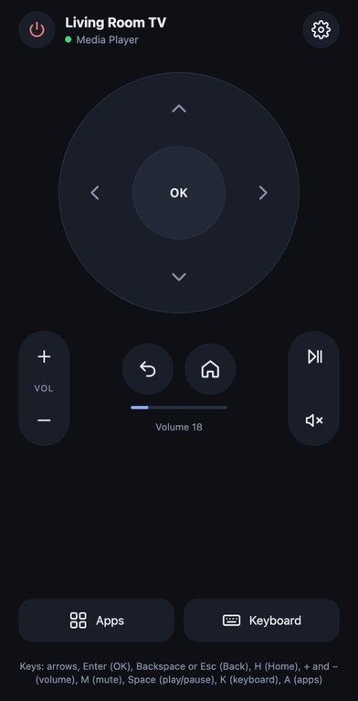
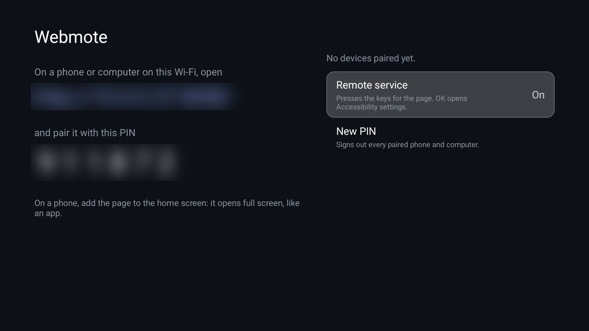
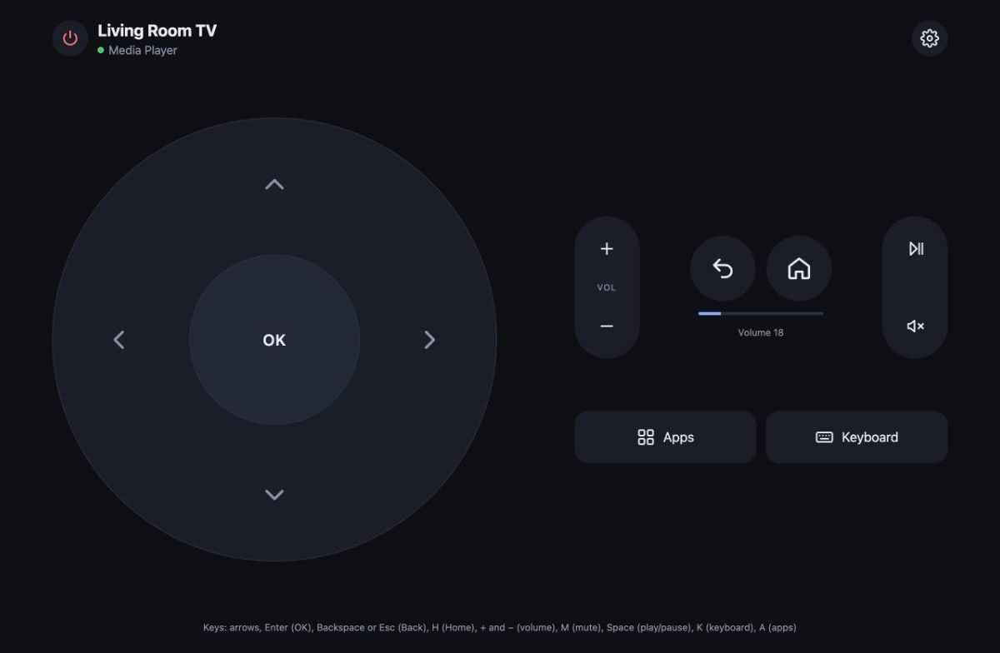

  

  <strong>A remote for your Android TV, in your phone's or computer's browser</strong>

  
  
  
  

<h1>Webmote</h1>

Webmote is an open-source remote for Android TV and Google TV that works in a web browser. Install it on the TV, open the address it shows on any phone, tablet or computer on the same Wi-Fi, type the PIN from the TV screen, and you have a remote like Google TV's: D-pad, OK, Back, Home, volume, play/pause, an Apps sheet and a keyboard for typing searches.

There is nothing to install on the phone and no account to sign in to, and nothing leaves your home network. Add the page to your phone's home screen and it opens full screen, like an app.

<h2>Screenshots</h2>

  
  &nbsp;&nbsp;
  

Left: the remote page (demo TV and apps). Right: Webmote on the TV, with the address and PIN blurred.

  

On a computer or a tablet on its side, the remote spreads out to fit the window (demo TV).

<h2>Features</h2>

<ul>
  <li><strong>Google-TV-style remote</strong>: D-pad with OK, Back, Home, volume up/down, mute, play/pause, and TV settings</li>
  <li><strong>Turn off</strong>: hold the power button for a second, so a stray tap doesn't</li>
  <li><strong>Apps sheet</strong>: every app on the TV with its banner; tap one to open it</li>
  <li><strong>Keyboard</strong>: type on your phone and the text appears in the TV's focused search or text box, then Enter to search</li>
  <li><strong>Now playing</strong>: the TV's name, the app in front, and the volume, kept up to date</li>
  <li><strong>Hold to repeat</strong> on the D-pad and volume, with a small vibration on phones that have it</li>
  <li><strong>Desktop keyboard shortcuts</strong>: arrows, Enter, Backspace or Esc, H, + and −, M, Space, K for the keyboard, A for apps</li>
  <li><strong>Home-screen app</strong>: a web app manifest and icons, so it opens full screen from the home screen</li>
  <li><strong>Paired, not open</strong>: a 6-digit PIN pairs each browser; wrong guesses lock pairing for longer each time; <strong>New PIN</strong> signs every device out. See <a href="#security">Security</a></li>
  <li><strong>Small</strong>: one ~45 KB APK, plain Java, no libraries, no tracking</li>
  <li>A <a href="https://github.com/Gathin23/cleanyourtv/blob/main/docs/modules.md">module card</a> for the <a href="https://github.com/Gathin23/cleanyourtv">Clean Your TV</a> launcher ("Webmote · Phone remote"); on any other home it's an ordinary app</li>
</ul>

<h2>Requirements</h2>

<ul>
  <li>An Android TV or Google TV device on <strong>Android 11 or newer</strong> (on Android 13 and newer the D-pad works everywhere; see Known Limitations for 11 and 12)</li>
  <li>A phone, tablet or computer with a modern browser, <strong>on the same network</strong> as the TV</li>
  <li>To install: a computer with <a href="https://developer.android.com/tools/releases/platform-tools">ADB</a> and Developer options → Network debugging on the TV, or any sideloading app on the TV</li>
</ul>

<h2>Installation and Setup</h2>

<h3>From a release (recommended)</h3>

<ol>
  <li>Download <code>Webmote-x.y.z.apk</code> from the <a href="../../releases/latest">latest release</a>.</li>
  <li>Install it and switch on its remote service:
<pre>
TV_HOST=&lt;tv ip&gt; APK=Webmote-0.1.1.apk ./install.sh
</pre>
  This installs the APK with <code>adb</code>, adds Webmote's remote service to the accessibility services already on (keeping theirs), and opens Webmote on the TV.</li>
</ol>

Installing without a computer: sideload the APK with any file manager or downloader app, open <strong>Webmote</strong>, choose <strong>Remote service</strong> and switch on <strong>Webmote</strong> in Accessibility settings. Some TVs hide that screen; then use <code>install.sh</code> once from a computer.

<h3>From source</h3>

JDK 17 and Android SDK platform 34 with build-tools 34.0.0:

<pre>
TV_HOST=&lt;tv ip&gt; ./install.sh
</pre>

It builds the app and installs it the same way. To build only: <code>./gradlew assembleRelease</code>; the JVM tests run with <code>./gradlew testReleaseUnitTest</code>. Where macOS blocks the stock <code>adb</code>, set <code>CLEANYOURTV</code> to a clone of <a href="https://github.com/Gathin23/cleanyourtv">Clean Your TV</a> with its tools set up, and its <code>tools/tv.py</code> is used instead.

<h2>Usage</h2>

<ol>
  <li>Open <strong>Webmote</strong> on the TV. It shows an address like <code>http://192.168.1.20:8080</code> and a 6-digit PIN.</li>
  <li>Open that address in the browser on your phone or computer, and type the PIN. The TV also shows the PIN in a corner while the browser is on the pairing page, so after the first time you can skip opening Webmote on the TV. The browser stays paired.</li>
  <li>Add it to your home screen:
    <ul>
      <li><strong>iPhone and iPad (Safari)</strong>: Share → <strong>Add to Home Screen</strong>. It opens full screen, like an app.</li>
      <li><strong>Android (Chrome)</strong>: ⋮ → <strong>Add to Home screen</strong>. Over plain HTTP, Chrome adds a shortcut that opens in a browser tab; tap the full-screen button at the top of the remote to hide the browser bars.</li>
      <li><strong>Computer</strong>: bookmark it, and use the keyboard shortcuts listed under the remote.</li>
    </ul>
  </li>
</ol>

The address is the TV's address on your network. If your router hands it a new one, Webmote shows the new address; give the TV a fixed address (a DHCP reservation in the router) to keep the home-screen icon working. If port 8080 is taken, Webmote uses the next free port, up to 8089.

On the TV, <strong>New PIN</strong> (press OK twice) makes a new PIN and signs out every paired phone and computer.

For scripts and home automation, the same calls the page makes are documented in <a href="docs/api.md">docs/api.md</a>.

<h2>How It Works</h2>

<pre>
   Phone / computer                         Android TV
  ┌────────────────┐   home Wi-Fi    ┌──────────────────────────┐
  │    Browser     │  HTTP + key     │  Webmote                 │
  │  remote page   ├────────────────►│  ├─ tiny HTTP server     │
  │ (home screen)  │◄────────────────┤  ├─ pairing (PIN → key)  │
  └────────────────┘   status, apps  │  └─ accessibility service│
                                     │      presses the keys    │
                                     └──────────────────────────┘
</pre>

Webmote runs a small HTTP server inside its accessibility service, so it serves the page while the service is on and stops when it's off. The page is a single HTML file inside the app.

<ul>
  <li><strong>D-pad, OK, Back, Home and Turn off</strong> are Android's own global actions for accessibility services, the same ones a switch-access device uses. No ADB, no root, and no input injection.</li>
  <li><strong>Volume and mute</strong> go through the audio service, and the TV shows its own volume bar. <strong>Play/pause</strong> is a media key, delivered to whichever app is playing.</li>
  <li><strong>Typing</strong> finds the text box that has focus on the TV and sets its text, like the Google TV app's keyboard does. Netflix draws its own keyboard with no text box behind it, so there Enter opens Netflix's search for what you typed, through the link Netflix offers for searching.</li>
  <li><strong>Apps</strong> are the ones with a TV launcher entry, opened the way the home screen opens them.</li>
</ul>

<h2>Security</h2>

Anything that can press a TV's keys can open apps and change settings, so Webmote is locked down by default:

<ul>
  <li>Only devices on your home network (private addresses, and VPN ranges like Tailscale's) can connect at all.</li>
  <li>Every control call needs a key that the TV gives out only for the PIN on its screen. After 5 wrong PINs, pairing locks for 30 seconds, doubling up to 5 minutes. A browser on the pairing page can ask the TV to show the PIN in a corner of its screen for a minute; that shows it to the room, not to the browser.</li>
  <li>The TV stores only hashes of the keys. Pages on other websites can't use your paired browser to control the TV (no CORS, DNS-rebinding protection).</li>
  <li>No accounts, no cloud, no analytics: nothing leaves your network.</li>
</ul>

<strong>Never forward port 8080 to the internet.</strong> Webmote speaks plain HTTP on the home network, the usual trade-off for a local device. To use it away from home, use a VPN to your home network. Details, and how to report a vulnerability: <a href="SECURITY.md">SECURITY.md</a>.

<h2>Known Limitations</h2>

<ul>
  <li><strong>It can't turn the TV on.</strong> A TV in standby is off the network, so nothing on Wi-Fi can reach Webmote. Use the TV's remote, HDMI-CEC from another device, or a voice assistant to turn it on.</li>
  <li><strong>The D-pad on Android 11 and 12 works in most apps, not all.</strong> The D-pad actions for accessibility services arrived in Android 13. Before that, Webmote moves the TV's focus itself and OK clicks what has it. That follows apps built from standard Android views (home screens, settings, most app menus), but not apps that draw their own screen, such as some games and video players. Not yet tested on an Android 11 or 12 TV: reports welcome. Android 10 and older aren't supported.</li>
  <li><strong>Android Chrome won't install it as a full app over HTTP.</strong> Browsers only install web apps from HTTPS, which a TV on a private address can't get. iPhone home-screen web apps open full screen anyway; on Android use the full-screen button.</li>
  <li><strong>Some apps ignore the keyboard.</strong> Apps that draw their own on-screen keyboard instead of a real text box can't receive typed text; use the D-pad there. Netflix is the exception: type, then press Enter to search it.</li>
  <li><strong>The remote service has to stay on.</strong> Some TVs turn accessibility services off after an update or when memory is short; open Webmote on the TV to see whether it's on.</li>
</ul>

<h2>Tested On</h2>

MOKA R8G (Android 14). Verified from a computer on the same network: pairing with the PIN and refusing a wrong one; calls without a key refused; a request with a host name instead of the TV's address refused; Home, Back, left and right, and TV settings; the Apps list (73 apps), app banners and opening an app, with an app outside the TV launcher list refused; the TV's name and the app in front; "no text box has focus" when there was none; the pairing surviving an app update. The remote page was checked in desktop Chrome against a stand-in for the TV.

Not tested yet: volume, mute and play/pause (the test TV stayed muted), Turn off, typing into a real text box, and the page on an iPhone or Android phone, including the home-screen app. Reports welcome: <a href="../../issues">open an issue</a>.

<h2>License</h2>

This project is licensed under the MIT License.

See the [LICENSE](LICENSE) file for details.
Full license text: https://opensource.org/licenses/MIT

<h2>Contributing</h2>

Pull requests are welcome. Open an issue first to discuss ideas or report bugs. See <a href="CONTRIBUTING.md">CONTRIBUTING.md</a> and the <a href="CODE_OF_CONDUCT.md">Code of Conduct</a>.

<h2>Related Projects</h2>

<ul>
  <li><a href="https://github.com/Gathin23/cleanyourtv">Clean Your TV</a>: debloat tools and a lean launcher for Android TV, whose module cards Webmote supports</li>
  <li><a href="https://github.com/maxhayim/corner-player">Corner Player</a>: your own camera or stream in a corner of the TV, over any app</li>
  <li><a href="https://github.com/maxhayim/ShackScreen">ShackScreen</a>: an Android TV dashboard for radio operators</li>
</ul>

<h2>Acknowledgments</h2>

The remote's layout follows the familiar Google TV remote; the icons and art are Webmote's own. 
Android™, Android TV™ and Google TV™ are trademarks of Google LLC, and iPhone® and Safari® are trademarks of Apple Inc.; they are used here solely to describe compatibility. Webmote is not affiliated with or endorsed by Google or Apple.
All other trademarks are the property of their respective owners.

